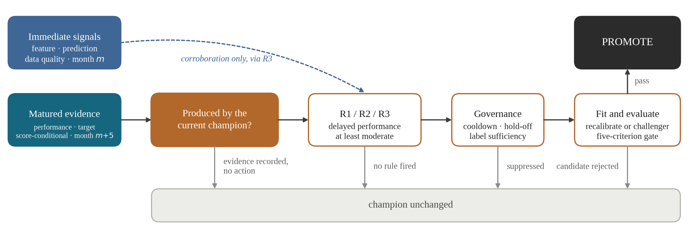
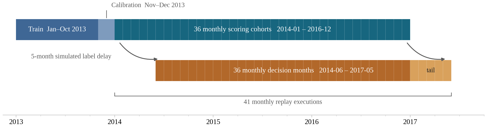
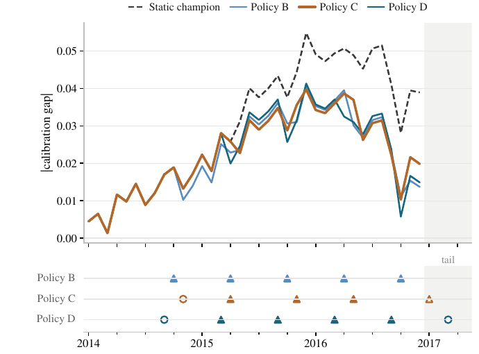
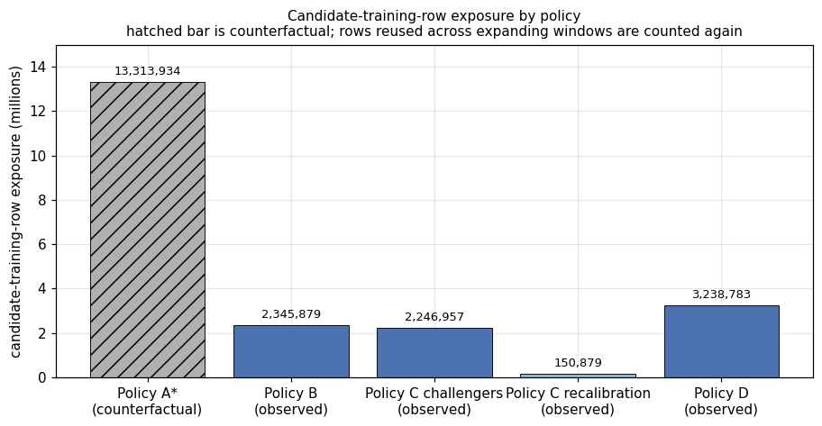

# Drift-aware credit-risk monitoring under delayed labels

[](https://github.com/saharimani/drift-aware-credit-risk-mlops/actions/workflows/ci.yml)

**When should a deployed credit-risk model be recalibrated or replaced, if the outcomes that prove it has degraded arrive months later?**

This is my MSc Data Science dissertation (Queen Mary University of London, 2026, graded Distinction). I built a governed intervention policy for an XGBoost default model, evaluated it against three alternative policies on 1.04M Lending Club loans, and replayed it month by month as a containerised Cloud Run Job, with its state stored in BigQuery.

`Python` · `XGBoost` · `scikit-learn` · `pandas` · `SciPy` · `BigQuery SQL` · `Cloud Run Jobs` · `Cloud Storage` · `Cloud Scheduler` · `Artifact Registry` · `Docker` · `pytest` · `GitHub Actions`

---

## The problem

A lending model gets two kinds of evidence after deployment:

- **Immediate signals:** feature drift, prediction drift and data quality. These are available the day a cohort is scored, but a shift in the inputs does not prove the model is worse.
- **Delayed outcomes:** whether the loans actually went bad. This is what tells you the model has degraded, but it arrives months later. By then the model may already have been replaced, so the evidence can describe a model that is no longer running.

Retraining on every drift alert is wasteful. In this data, feature drift fired in 33 of 36 months. Never retraining lets calibration decay. The policy here sits between the two.

## What the policy does



1. Each month's cohort is scored by the current champion. The probabilities are **frozen** and never re-scored.
2. Immediate drift is treated as a **warning only**. It can corroborate a decision, but it cannot start one.
3. When labels mature (simulated 5-month delay), the evidence is matched back to **the champion that produced those scores**. If that champion has since been replaced, the evidence is recorded but cannot act against its successor. This happened for 19 matured cohorts.
4. Three trigger rules (R1–R3) use delayed performance, score-conditional outcome drift and persistence across cohorts.
5. A deployment cooldown and an evaluation hold-off stop the policy from thrashing.
6. An action fork chooses between **recalibration** (a logistic layer on the log-odds, used when the ranking is intact and only the level has shifted) and a **full challenger**.
7. Every candidate must pass a **five-criterion promotion gate**: Brier score, calibration gap, log loss, an AUC guardrail and a minimum validation size. Fitting a candidate and deploying it are separate decisions.



## Data and model

- Lending Club resolved loans, 2013–2016: **1,176,374** loans in total.
  - 2013: training (105,074) and calibration (29,740).
  - 2014–2016: 36 monthly cohorts, **1,041,560** loans, replayed as the live stream.
- A leakage audit gave every column an explicit role. 32 post-origination fields were excluded, and medians for imputation were learned from 2013 only.
- XGBoost champion with 67 features.
  - Calibration-window ROC-AUC 0.699 and Brier 0.122.
  - Over the stream, the realised bad-loan rate rose from 0.154 to a peak of 0.212.

## Results

### Intervention burden

| Policy | Trigger | Candidate evaluations | Fits | Gate rejections | Promotions (in stream + tail) |
|---|---|---|---|---|---|
| A: naive feature drift (shadow) | feature drift | 33 requests | 0 | – | – |
| B: governed feature drift | feature drift + governance | 5 | 5 | 0 | 5 + 0 |
| **C: governed multi-signal (proposed)** | delayed evidence (R1–R3) | **5** | **5** | **1** | **3 + 1** |
| D: six-month calendar | schedule | 6 | 6 | 2 | 4 + 0 |

In November 2014, Policy C fitted a challenger and the gate **rejected** it. The champion stayed in place, and the regression tests reproduce this decision.

### Managed performance (36 cohorts, mean across months)

| | Brier | abs. calibration gap | max monthly calibration gap | ROC-AUC |
|---|---|---|---|---|
| Static champion (no intervention) | 0.1417 | 0.0305 | 0.0548 | 0.7072 |
| Policy B | 0.1397 | 0.0222 | 0.0408 | 0.7157 |
| **Policy C** | 0.1402 | 0.0229 | **0.0397** | 0.7127 |
| Policy D | 0.1398 | 0.0225 | 0.0413 | 0.7150 |



- **Every governed policy beat the static champion.** All 12 paired block-bootstrap intervals excluded zero. For Policy C, the Brier score fell by 0.00147 (95% CI 0.00057 to 0.00238).
- **Non-inferiority.** Margins were fixed in advance: 0.001 Brier, 0.003 calibration gap, 0.01 AUC. With moving-block bootstrap (500 replicates), Policy C stayed within every margin against both B and D at the primary 3-month block length, and at 2-month blocks.
- **Where it failed.** At 6-month blocks, the upper Brier bound against Policy B was **0.00116, above the 0.001 margin**. The non-inferiority conclusion therefore depends on block length, and I report it that way.

### Compute

Retraining on every feature-drift alert (counterfactual A\*) would have fitted 27 challengers on 13.3M cumulative training rows. Policy C fitted four challengers and one recalibration on 2.40M rows in total, **82% less** (83% counting challenger fits only). Policy B's figure is also 82%.



## Cloud implementation

The Notebook 05 policy loop became a **stateless monthly job**. The policy's state lives outside the container.

```
Cloud Scheduler ─► Cloud Run Job (Docker, 4 vCPU / 16 GiB) ─► BigQuery
   (monthly)          main.py --month YYYY-MM                    policy_state (one row)
                         │                                       prototype_scores (frozen)
                         ▼                                       monitoring_metrics
                   Cloud Storage                                 delayed_evidence
                   artefacts, versioned champions                policy_decisions
                   + frozen monitoring references                candidate_attempts
                                                                 policy_promotions, prototype_runs
```

- **Idempotent writes.** Every table write is a staged `MERGE` on a natural key, with the staging schema taken from the target table ([`storage.merge_rows`](src/storage.py)). Re-running a month updates rows in place rather than duplicating them.
- **Duplicate-run protection.** A month that already has a terminal decision is skipped. Two duplicate runs were recorded and excluded during the replay.
- **The champion comes from state**, not from the newest file in the bucket.
- **Least-privilege service account.** It is created and bound to scoped roles by [`deploy_cloud_run_job.sh`](scripts/deploy_cloud_run_job.sh), which also covers the image build, Artifact Registry, the job and the scheduler.
- **15 SQL acceptance tests** ([`sql/acceptance_tests.sql`](sql/acceptance_tests.sql)). They check, for example, that no label is used before it matures, each cohort is scored exactly once, superseded evidence never triggers a candidate, a rejection leaves the champion unchanged, and a duplicate run creates no duplicate decisions.

**Replay results:**
- 41 executions: 36 scoring months and 5 tail months that only mature the last labels.
- 1,625 s of total wall-clock time, with a mean of 39.6 s per month.
- [Parity against the offline notebook](docs/cloud_evidence/parity_results.json): **36/36 cohorts and 36/36 decisions matched.** The largest metric difference was 1.1 × 10⁻¹⁶.

## Repository layout

```
src/            the deployed job: main, storage, state, signals, evidence, policy, candidate
scripts/        deploy, artefact upload, full replay driver, offline/cloud parity check
sql/            BigQuery schemas and acceptance tests
config/         job configs (project identifiers replaced) and the frozen policy metadata
notebooks/      01 data audit → 02 preprocessing → 03 champion → 04 monitoring → 05 policies → 06 compute
results/        summary tables behind every number in this README
docs/           figures and sanitised Cloud Run / Scheduler / parity exports
tests/          pytest suite (45 tests)
```

`src/`, `scripts/` (except `computational_burden_analysis.py`), `sql/` and the `Dockerfile` are **byte-identical to the code in the validated container image**. CI checks this against [`SHA256SUMS.txt`](SHA256SUMS.txt) on every push. For publication I replaced the project identifiers in `config/` and rewrote the header comment of `requirements.txt`. The pinned versions are unchanged.

## Running it

```bash
pip install -r requirements.txt -r requirements-dev.txt
pytest            # 45 tests, no cloud credentials needed
```

The tests cover the monitoring statistics (PSI, JSD and Benjamini–Hochberg, checked against statsmodels), the trigger rules, the action fork and the promotion gate. A regression test also re-runs the gate on all five recorded candidate attempts and checks that it reaches the same pass/fail verdict and failed criteria as the original replay.

To run the job itself, you need a GCP project, the Lending Club data and the notebook artefacts uploaded to Cloud Storage. See the comments at the top of each script in `scripts/`.

## Limitations

- **This is a historical replay, not a live deployment.** One portfolio, 2013–2016.
- **The label delay is simulated** (five months), and many real loans take far longer to resolve. Detection and intervention delays should be read as lower bounds.
- **Only Policy C was replayed on Cloud Run.** Policies B and D were evaluated offline, and the A\* compute figure is a reconstructed counterfactual.
- **The non-inferiority result is sensitive to block length**, as described above.
- **Engineering gaps.** The cloud job has no local or mock mode and no tests against BigQuery itself; the SQL acceptance tests run against the real dataset after a replay. `run_month` and `try_candidate` in `main.py` are long and would be the first things I'd split up.

The raw data (1.7 GB) and the model artefacts aren't included. The notebooks keep their outputs, so the full analysis can be read without re-running it.
